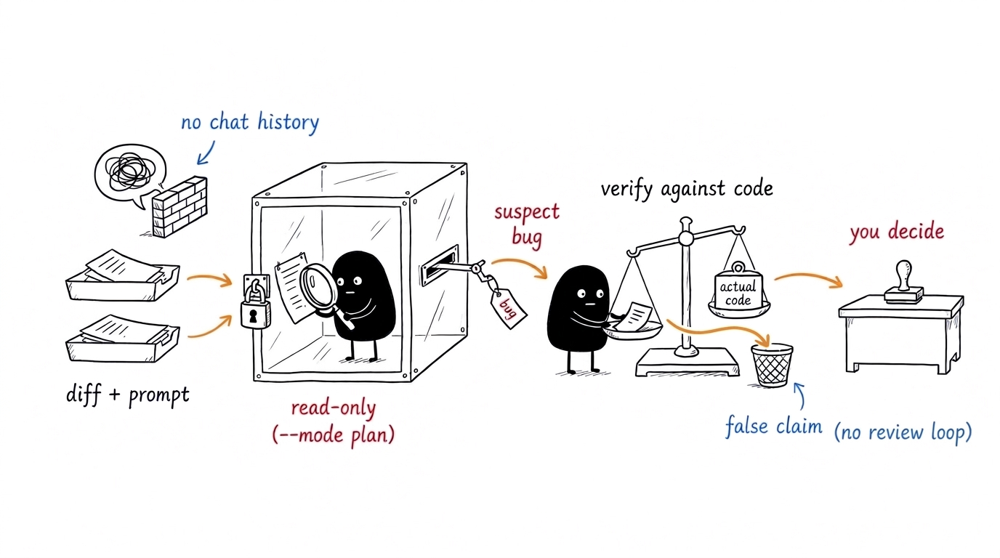
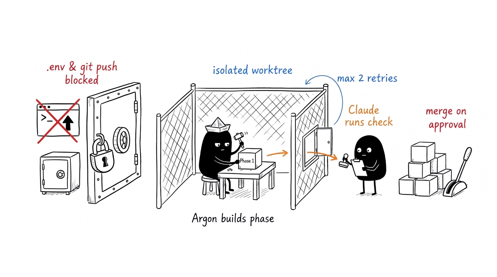

<h1 align="center">argon-bridge</h1>

<p align="center">
  <a href="https://github.com/fatihaydost/argon-bridge/actions/workflows/test.yml"></a>
  <a href="LICENSE"></a>
</p>

**A Claude Code plugin that bridges Claude and Gemini 4 Argon: independent plan/commit review, second opinions, and opt-in delegated coding in an isolated worktree.**

Long coding sessions build blind spots: Claude starts sharing your assumptions, misses a requirement that was only half implemented, fixes a symptom instead of the root cause, or leaves the same bug sitting in a sibling file.

`argon-bridge` gives **Gemini 4 Argon** (via the `agy` CLI) your raw messages, the plan or diff, and read-only access to the repository—without ever showing it Claude's conversation history. Claude verifies every claim against the actual code, drops false alarms, and brings only confirmed issues to you for approval.



---

## Quick Start

### 1. Prerequisites

- [Claude Code](https://code.claude.com)
- Python 3.9+ and `git`
- Antigravity CLI (`agy`) logged in with an account that has access to **Gemini 4 Argon**:

```bash
agy models | grep argon
```

### 2. Install the Plugin

Run inside your terminal:

```bash
claude plugin marketplace add fatihaydost/argon-bridge
claude plugin install argon-bridge@argon-tools
```

### 3. Verify & Enable Secret Protection

Inside Claude Code, check that `agy` and Argon are detected and turn on secret-file blocking (`.env`, SSH/cloud keys, credentials):

```text
/argon-bridge status
/argon-bridge permissions on
```

That's it. In the default `standard` mode, Argon now automatically reviews your **plans** and **commits**.

> **Platform support:** Linux and macOS are used daily. On Windows, the full 293-test suite passes in CI under Git Bash (`python3`, `python`, or `py -3`), though end-to-end usage with a live `agy` binary on Windows has not been field-tested yet.

---

## How It Works

### 1. Automatic Plan & Commit Reviews

1. **Fresh eyes, zero shared assumptions** — On a plan exit or a `git commit`, Argon receives only your own prompts, the plan or diff, and read access to the repo (`agy --mode plan`). It never sees Claude's reasoning, so it doesn't inherit Claude's blind spots.
2. **Plans wait up to 2 minutes; commits never block you:**
   - **Plans:** Wait up to `plan_wait` (default `120s`) in the foreground. If Argon finishes in time with findings, the plan is held so Claude can address them. If a large plan takes longer, the review continues in the background while you move ahead.
   - **Commits:** Go through immediately (`< 1s`). Argon reviews the commit in the background (typically 2–8 minutes) and wakes Claude automatically (`asyncRewake`)—or delivers the findings on your next message, Bash call, or Stop. Argon reads a temporary snapshot of the reviewed commit (a detached `git worktree` in argon-bridge's state folder, removed afterwards, checkout hooks off), so edits made during the review do not mix in. The snapshot holds tracked files only: ignored ones (`node_modules`, `.venv`, local config) are absent, so Argon cannot read dependency code during commit reviews.
3. **Claude verifies every claim** — Argon's output is treated strictly as untrusted data, never as instructions. Claude checks each finding's quoted evidence and line numbers against the codebase, tells you which findings are real and which are false positives, and waits for your approval.
4. **No review loops** — Once you approve a fix, that fix commit is not re-reviewed.

> **Multi-session safe:** Several Claude Code sessions can work in the same checkout simultaneously. Each session only reviews its own commits and the files it edited. If Argon is offline or out of quota, your work is never blocked—you just see a one-line notice explaining why the check was skipped. Small changes (a single file under 30 lines, or docs-only edits) are skipped automatically.

### 2. On-Demand Reviews & Independent Second Opinions

You don't have to wait for a commit or plan to consult Argon:

- **Review uncommitted changes or a document right now:**
  ```text
  /argon-bridge review
  /argon-bridge review --file docs/audit-report.md
  ```
  If you later commit the exact same diff, the cached review result is reused instead of calling Argon again.

- **Get an independent second opinion (`ask`):**
  ```text
  /argon-bridge ask "Should discount calculation live inside Cart.total or in a separate service?"
  /argon-bridge ask "Is this schema ready for multi-tenant isolation?" --repo ~/code/api
  /argon-bridge ask "Audit this migration plan for edge cases" --file docs/migration.md --findings
  ```
  Claude writes down its own position *while* Argon is thinking, then shows **Argon's verbatim answer** side-by-side with **Claude's view** (where they agree, where they disagree, and why). With `--findings`, Argon returns up to 15 structured findings (`claim`, `file`, `line`, `evidence`), each verified by Claude against the repo.

---

## Commands & Modes

Run these inside Claude Code (or directly in your terminal via `argon-bridge <command>`):

| Command | What it does |
| --- | --- |
| `/argon-bridge status` | Shows `agy` & Argon availability, active settings, running background checks, waiting inbox results, recent history, and delegated jobs. |
| `/argon-bridge review` | Reviews uncommitted changes in the foreground. Add `--repo PATH` for another repo or `--file PATH` (repeatable) to review specific files even when nothing changed in git. |
| `/argon-bridge ask "<question>"` | Gets Argon's independent opinion alongside Claude's view. Supports `--repo PATH`, `--file PATH` (repeatable), `--findings` (up to 15 verified findings), and `--timeout SECONDS`. |
| `/argon-bridge mode thorough\|standard\|off` | Controls when Argon runs automatically (see table below). Default: `standard`. |
| `/argon-bridge effort low\|medium\|high` | Controls how deeply Argon thinks during reviews. Higher catches more bugs but takes longer. Default: `medium`. |
| `/argon-bridge permissions on\|off` | Blocks Argon from reading `.env`, private keys, and home credential folders via temporary per-run `agy` project rules. Default: `off`. |
| `/argon-bridge delegate` | Hands a phased coding task to Argon in an isolated git worktree while Claude checks each phase (or just ask Claude in plain English). |

> **Terminal usage:** When run outside Claude Code (`bin/argon-bridge`), `review` and `ask` work on disk changes without session messages. `delegate start` and `delegate adopt` require an active Claude Code session so phase results have a session to return to.

### Review Modes

| Mode | Automatic triggers | Second opinions (`ask`) |
| --- | --- | --- |
| `standard` *(default)* | Plans and commits | Claude asks you for permission before consulting Argon on hard architectural choices |
| `thorough` | Plans, commits, and end-of-task (`Stop`) | Claude consults Argon automatically before hard-to-reverse decisions (architecture, schema, public API) |
| `off` | None | Only when you explicitly run `review` or `ask` |

---

## Hand Work to Argon (Opt-in Delegation)

By default, Argon is strictly read-only. However, when you explicitly tell Claude in your own words—*"give this to Argon"*, *"let Argon write the tests"*, or `/argon-bridge delegate`—Argon can **implement** a task in an isolated sandbox while Claude acts as the lead reviewer:



1. **Isolated Worktree & Phased Plan** — Claude breaks the work into phases, each with an automated done-check command, selects relevant context files and safe skills, and starts the job (`delegate start`). Argon gets a dedicated branch `argon/<job>` in an isolated git worktree under `~/.local/state/argon-bridge/worktrees/`—it never touches your working directory.
2. **Background Execution & Phase Gate** — Argon builds each phase in the background (`agy --mode accept-edits --sandbox`). When a phase finishes, Claude runs the phase's check command, inspects the diff, and either commits the phase (`delegate check … pass`, using your git author identity with no AI co-author tags) or sends revision notes back (`fail`). After **2 failed fix rounds**, Claude steps in, fixes the phase itself, and tells you.
3. **Questions & Escalation** — If Argon hits an ambiguity, Claude answers anything settled by the plan, project rules, or code, and only interrupts you for genuine product or scope decisions.
4. **Fast-Forward Merge on Your Approval** — Once all phases pass, Claude summarizes the result and merges (`delegate merge`) only after you approve. (`delegate reject` aborts a running phase and cleans up the branch and worktree.)

<details>
<summary><strong>Delegation Details: Sandbox Permissions, <code>.env</code> Linking, Skills & Quota</strong></summary>

- **Strict command & file allowlist (`permissions on` required):** Each delegated phase runs with temporary per-job `agy` rules. Allowed shell commands are limited to plain inspection (`ls`, `wc`, `git status|log|show`, pathless `git diff` without quotes, `$`, `;`, `|`, or `&`), the exact phase check commands (including each leg of an `a && b` chain), and explicit `--allow` prefixes. Outbound terminal commands (`git push`, `git remote`, `gh`, `curl`, `wget`, `ssh`, `scp`, `rsync`, `sudo`, `rm -rf`, deploy/publish commands), `git diff` outside the worktree, and shell file-readers (`cat`, `grep`, etc.) are denied so file rules cannot be bypassed. Any unapproved command or file read ends Argon's turn immediately and notifies Claude. Terminal commands run inside `agy --sandbox` (Argon's own built-in `search_web` tool remains available).
- **Dependencies & `.env` (`--link` and `--setup`):** Claude can link `node_modules`, `.venv`, or `.env` into the worktree (`--link`) and run pre-phase setup commands (`--setup "pnpm install --offline"`, repeatable). Argon itself is blocked from reading `.env`, though tests it executes load `.env` as your user—keep raw secrets out of test stdout.
- **Curated context & skills:** Files marked `remote_allowed: false` in front matter are never sent. External-action skills (deploy, publish, messaging, cloud docs, issue trackers), memory skills, and `argon-bridge` itself are automatically excluded. Customize via `worker_skills.always` and `worker_skills.never`. Recurring mistakes caught by Claude are appended as one-liners to that repo's Argon notes for future jobs.
- **Quota & session resilience:** If Argon hits a quota limit mid-phase, the job pauses (`paused_quota`) rather than dumping unfinished work on Claude; `delegate resume` continues the exact same Argon conversation later. Stalled phases (`stall_seconds`, default `300s` with no `agy` event while no command is running) are stopped cleanly. Jobs survive session restarts and can be claimed from another session with `delegate adopt`.
- **Worker CLI tuning:** `argon-bridge worker-effort low|medium|high` (default `medium`) and `argon-bridge worker-timeout SECONDS` (`300`–`14400`, default `3600`).

</details>

---

## Configuration

All settings live in `~/.config/argon-bridge/config.json` and are optional:

```json
{
  "mode": "standard",
  "effort": "medium",
  "timeout": 900,
  "plan_wait": 120,
  "ask_timeout": 400,
  "manage_agy_permissions": true,
  "private_roots": ["~/notes", "~/client-vault"],
  "decisions": {
    "/abs/path/to/repo": "/abs/path/to/decisions.md"
  },
  "worker_effort": "medium",
  "worker_timeout": 3600,
  "stall_seconds": 300,
  "worker_skills": {
    "always": [],
    "never": []
  }
}
```

| Key | Default | Description |
| --- | --- | --- |
| `mode` | `"standard"` | Automatic review trigger level: `"thorough"`, `"standard"`, or `"off"`. |
| `effort` | `"medium"` | Argon reasoning depth for reviews and `ask`: `"low"`, `"medium"`, or `"high"`. |
| `timeout` | `900` | Max seconds for a background commit/Stop review (`30`–`1800`). Foreground `review` caps at `400s`. |
| `plan_wait` | `120` | Max seconds a plan waits in the foreground (`1`–`400`) before moving to the background. |
| `ask_timeout` | `400` | Default seconds `ask` waits (`30`–`timeout`); override per call with `ask --timeout N`. |
| `manage_agy_permissions` | `false` | Set via `permissions on\|off`. Writes temporary per-run secret-blocking rules to `~/.gemini/config/projects/`. |
| `private_roots` | `[]` | Paths Argon must never access. Commits there are skipped; plans there are reviewed from plan text only. |
| `decisions` | `{}` | Map of `"/abs/repo": "/abs/decisions.md"` so Argon knows deliberate architectural choices and won't flag them. Files with `remote_allowed: false` are never sent. |
| `worker_effort` | `"medium"` | Argon reasoning depth when executing delegated phases (`"low"`, `"medium"`, `"high"`). |
| `worker_timeout` | `3600` | Max seconds per delegated phase (`300`–`14400`). |
| `stall_seconds` | `300` | Seconds of silence from `agy` (while no child command is running) before a delegated phase is marked `stalled`. |

Logs, session state, and isolated worktrees are stored under `~/.local/state/argon-bridge/`.

---

## Privacy & Security

### What is sent to Google (`agy`)

- Your own user prompts in the calling Claude session (recent prompts for reviews; session prompts for `ask`).
- The diff or plan being reviewed, any files explicitly passed via `--file` (never secret files or `private_roots`), and the repo's configured `decisions` file.
- Any file Argon opens inside the reviewed repository (unless the repository is in `private_roots`); for commit reviews, inside the snapshot of the reviewed commit.
- For opt-in delegated work: the phase packet (plan, selected context files, Claude's check notes) and files/test outputs inside the isolated worktree.

Nothing else. Review your organization's policy and Google's Antigravity terms before running on proprietary repositories.

### Secret File Protection (`permissions on`)

Without rules, `agy` can read `.env` or key files in a repository like any other file. Turning on `/argon-bridge permissions on` gives every Argon run an isolated, temporary project configuration in `~/.gemini/config/projects/` (`agy --project`) that blocks reading:

- **Repository secrets:** `.env`, `.env.*` (except example/sample templates), `.envrc`, private SSH keys, `*.pem`, `*.key`, `*.p12`, `*.pfx`, `*.keystore`, `*.jks`
- **Home credentials:** `~/.ssh`, `~/.aws`, `~/.config/gcloud`, `~/.config/gh`, `~/.git-credentials`, `~/.netrc`, `~/.docker`, `~/.kube`, `~/.gnupg`, `~/.npmrc`, `~/.pypirc`

Your global `agy` settings files are never modified, and the temporary project file is removed as soon as the run finishes.

---

## Development

```bash
python3 -m unittest -v      # runs all 293 tests with a fake agy binary (no network)
claude --plugin-dir .       # test the plugin locally in Claude Code
claude plugin validate .    # validate plugin manifest and structure
```

## License

[MIT](LICENSE)
